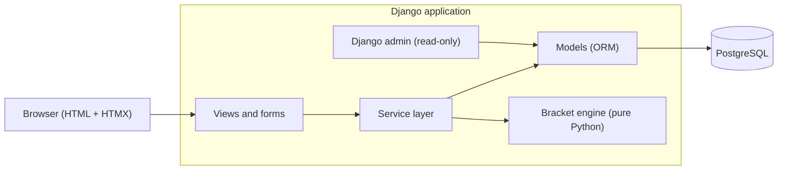
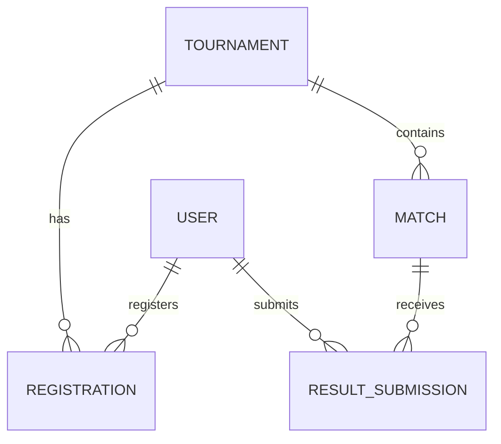
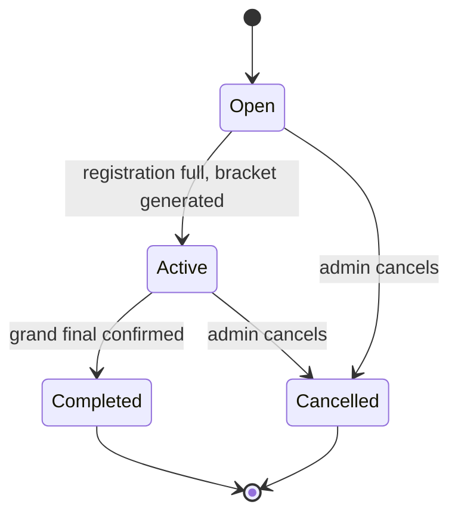
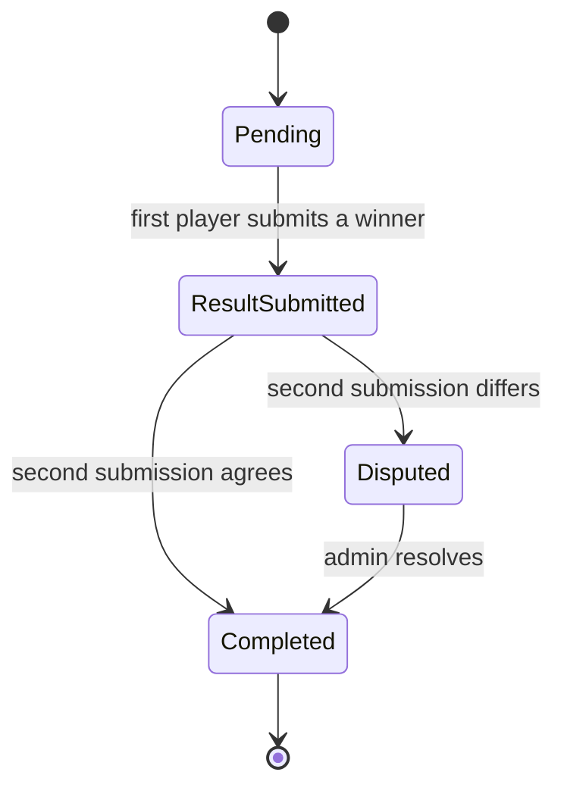

# Zenith — Architecture

Proof-of-concept esports tournament platform. This document defines the technology stack, system structure, data model, tournament engine, business rules, and implementation plan. It contains no code by design.

**Chosen stack:** Django + PostgreSQL, server-rendered templates with HTMX.

---

## 1. Purpose and scope

Zenith runs individual-player, double-elimination tournaments end to end:

> Create → Register → Generate → Play → Report → Resolve → Advance → Finish

In scope: accounts, tournament creation, registration, automatic bracket generation, result submission, dispute resolution, automatic advancement, tournament completion, six screens (login/register, tournament list, create tournament, tournament page, admin dashboard, match result).

Out of scope: everything listed in the scope document's "Deliberately Excluded" section (teams, rankings, notifications, chat, spectators, scheduling, payments, and so on).

The architecture is driven by three observations about the scope:

1. **Correctness matters more than scale.** The hard part is keeping the bracket consistent under concurrent actions, not throughput. A tournament has at most 126 matches.
2. **Real-time is not required.** Notifications, chat, and spectators are excluded, so periodic refresh of the bracket is enough.
3. **The bracket is fully predictable.** Sizes are 8, 16, 32, or 64 only, so there are never byes and the whole structure can be generated up front.

---

## 2. Decisions at a glance

| Concern | Decision | Reason |
|---|---|---|
| Language / framework | Python + Django (latest supported LTS at project start) | Batteries included: ORM, auth, forms, permissions, admin. Least code for this scope. |
| Database | PostgreSQL | Real transactions, row-level locking (`SELECT ... FOR UPDATE`), check and unique constraints. SQLite is not used, even in development, because it does not provide row locking. |
| Front end | Django templates + HTMX + small hand-written CSS/JS | Six screens and no real-time need. No separate SPA, no API layer to build. |
| Bracket rendering | Server-rendered HTML/CSS (round columns, CSS connectors) | Keeps the bracket a plain template, no JS charting library. |
| Auto-refresh | HTMX polling of a bracket fragment (about every 10 s while a tournament is active) | Simplest way to keep the bracket current without WebSockets. |
| Auth | Django session authentication, custom user model from day one | Built in, secure defaults (hashing, CSRF, sessions). |
| Admin role | `is_staff` flag on the user | Simplest admin/player split; also required by Django's admin site. |
| Business logic | Dedicated service layer + a framework-free bracket engine | Keeps rules testable and prevents logic drifting into views or templates. |
| Background jobs | None | Bracket generation runs synchronously when the last player registers. |
| Testing | pytest + pytest-django | Unit tests for the engine, integration tests for services, end-to-end test for the Definition of Done. |
| Packaging / run | Docker Compose (web + PostgreSQL), gunicorn, WhiteNoise for static files | One-command setup; no separate web server needed for a POC. |
| Configuration | Environment variables, split settings (base / dev / prod) | Standard twelve-factor approach. |

---

## 3. System architecture



### 3.1 Layers and responsibilities

| Layer | Responsibility | Must not |
|---|---|---|
| **Views / forms / templates** | Parse requests, check who the user is, call one service operation, render the result. | Contain business rules or touch multiple models to enforce a rule. |
| **Service layer** | Every state-changing operation (register, submit result, resolve dispute, and so on). Owns transactions, locking, and permission checks tied to the domain. | Render HTML or read request objects. |
| **Bracket engine** | Pure functions: generate the match structure for N players, place players in first-round slots, compute where a winner and loser go. | Import Django, touch the database, or know about users. |
| **Models** | Data shape and database-level constraints (unique, check, foreign keys). | Hold workflow logic. |
| **Django admin** | Back-office inspection and user management. | Be used to edit matches or registrations (see section 10). |

Dependency direction is one way: views → services → (models, engine). The engine depends on nothing.

### 3.2 Project layout

```
zenith/
├── manage.py
├── config/                  # settings (base/dev/prod), root urls, wsgi
├── apps/
│   ├── accounts/            # custom User, register/login, permission mixins
│   ├── tournaments/         # Tournament, Registration, tournament services, list/detail/create/dashboard views
│   └── matches/             # Match, ResultSubmission, result/dispute services, match views
├── engine/                  # pure-Python bracket engine (no Django imports)
│   ├── structure.py         # build match graph for N players
│   ├── seeding.py           # first-round placement
│   └── advancement.py       # where the winner and loser of a match go
├── templates/               # base layout, screens, HTMX fragments
├── static/                  # CSS, HTMX, small JS
├── tests/
│   ├── engine/              # exhaustive tests for all four sizes
│   ├── services/            # rule enforcement, concurrency
│   └── e2e/                 # the Definition of Done scenario
├── Dockerfile
└── docker-compose.yml
```

---

## 4. Domain model



Additionally, each match points to the match its winner goes to and the match its loser goes to (self-references, described below).

### 4.1 User

Custom user model extending Django's `AbstractUser`, defined before the first migration.

| Field | Notes |
|---|---|
| `username` | Login name and public player identity. Unique. |
| `password` | Hashed by Django. |
| `is_staff` | `true` means admin. Admin accounts are created via `createsuperuser` or a seed command; the public registration form only creates players. |

No profile fields, no email requirement.

### 4.2 Tournament

| Field | Notes |
|---|---|
| `name` | Required. |
| `game` | Text. One game is supported; the create form offers a single configured value. Stored as text so multi-game support later is a small migration. |
| `participant_limit` | One of 8, 16, 32, 64. Database check constraint. |
| `status` | `OPEN`, `ACTIVE`, `COMPLETED`, `CANCELLED`. |
| `created_by` | Admin user. |
| `created_at`, `started_at`, `completed_at` | Timestamps (UTC). |
| `winner` | Nullable user. Set only when the tournament completes. |

### 4.3 Registration

| Field | Notes |
|---|---|
| `tournament`, `player` | Foreign keys. **Unique together**, which prevents duplicate registration at the database level. |
| `registered_at` | Timestamp. |

### 4.4 Match

All matches of a tournament are created when the bracket is generated.

| Field | Notes |
|---|---|
| `tournament` | Foreign key. |
| `bracket` | `WINNERS`, `LOSERS`, `GRAND_FINAL`. |
| `round_number`, `match_number` | Position within the bracket. Unique together with `tournament` and `bracket`. |
| `slot_a`, `slot_b` | Nullable users. Empty until the feeder matches complete. |
| `status` | `PENDING`, `RESULT_SUBMITTED`, `DISPUTED`, `COMPLETED`. |
| `winner` | Nullable. When set, must equal `slot_a` or `slot_b` (check constraint). |
| `winner_next_match`, `winner_next_slot` | Where the winner is placed (`A` or `B`). Null for the grand final. |
| `loser_next_match`, `loser_next_slot` | Where the loser is placed. Null when the loser is eliminated (all losers-bracket matches and the grand final). |
| `resolved_by`, `resolved_at` | Set when an admin resolves a dispute. |

A match is **playable** when both slots are filled and its status is not `COMPLETED`. "Waiting for opponent" is derived from an empty slot, so no extra status is needed.

### 4.5 ResultSubmission

| Field | Notes |
|---|---|
| `match`, `submitted_by` | Unique together: one submission per player per match. |
| `claimed_winner` | Must be one of the two players in the match. |
| `submitted_at` | Timestamp. |

### 4.6 Database-level guarantees

- Unique: registration per (tournament, player); submission per (match, player); match position per tournament.
- Check: participant limit is 8/16/32/64; a match's winner is one of its two players; `slot_a` and `slot_b` differ.
- Foreign keys use `PROTECT` for players and tournaments: history is never silently deleted.

---

## 5. State machines

### 5.1 Tournament



Registration closes automatically when the participant limit is reached. The transition to `ACTIVE` happens in the same transaction as the last registration.

### 5.2 Match



`ResultSubmitted` corresponds to "Result Submitted" in the scope. Once a match is `COMPLETED` nothing about it can change.

---

## 6. Bracket engine

The engine is a small, dependency-free Python package. It answers three questions and nothing else:

1. *What matches exist for N players and how are they linked?*
2. *Which first-round slot does each player get?*
3. *Given a completed match, where do the winner and the loser go?*

### 6.1 Structure for N = 2^k players

| N | Winners rounds | Losers rounds | Winners matches | Losers matches | Grand final | Total matches |
|---|---|---|---|---|---|---|
| 8 | 3 | 4 | 7 | 6 | 1 | 14 |
| 16 | 4 | 6 | 15 | 14 | 1 | 30 |
| 32 | 5 | 8 | 31 | 30 | 1 | 62 |
| 64 | 6 | 10 | 63 | 62 | 1 | 126 |

General formulas: total matches = 2N − 2. Winners bracket round *r* has N / 2^r matches. Losers bracket rounds come in pairs: rounds 2j−1 and 2j both have N / 2^(j+1) matches, for j = 1 … k−1.

### 6.2 Routing rules

Let *i* be the match number within its round. "Odd → A, even → B" means an odd-numbered match feeds slot A of the next match and an even-numbered one feeds slot B.

**Winners bracket**
- Winner of round *r*, match *i* → winners round *r*+1, match ⌈i/2⌉, slot A if *i* odd else B.
- Winner of the winners final (round *k*) → grand final, slot A.
- Loser of round 1, match *i* → losers round 1, match ⌈i/2⌉, slot A if *i* odd else B. (Two first-round losers meet each other.)
- Loser of round *r* ≥ 2, match *i* → losers round 2(r−1), match *i*, slot B. (Drop-in against a losers-bracket survivor.)

**Losers bracket** (rounds 1 … 2(k−1))
- Odd rounds ("minor"): losers-bracket survivors play each other. Winner of round *s*, match *i* → losers round *s*+1, match *i*, slot A.
- Even rounds ("major"): survivors face players dropping in from the winners bracket. Winner of round *s*, match *i* → losers round *s*+1, match ⌈i/2⌉, slot A if *i* odd else B.
- Winner of the last losers round → grand final, slot B.
- The loser of any losers-bracket match is eliminated.

**Grand final:** winners-bracket champion (slot A) vs losers-bracket champion (slot B). Its winner is the tournament winner. See decision D1 for the no-reset assumption.

### 6.3 Worked example: N = 8 (14 matches)

Keys are `<bracket><round>-<match>` (WB = winners, LB = losers, GF = grand final).

| Match | Winner goes to | Loser goes to |
|---|---|---|
| WB1-1 | WB2-1 (A) | LB1-1 (A) |
| WB1-2 | WB2-1 (B) | LB1-1 (B) |
| WB1-3 | WB2-2 (A) | LB1-2 (A) |
| WB1-4 | WB2-2 (B) | LB1-2 (B) |
| WB2-1 | WB3-1 (A) | LB2-1 (B) |
| WB2-2 | WB3-1 (B) | LB2-2 (B) |
| WB3-1 (winners final) | GF-1 (A) | LB4-1 (B) |
| LB1-1 | LB2-1 (A) | eliminated |
| LB1-2 | LB2-2 (A) | eliminated |
| LB2-1 | LB3-1 (A) | eliminated |
| LB2-2 | LB3-1 (B) | eliminated |
| LB3-1 | LB4-1 (A) | eliminated |
| LB4-1 (losers final) | GF-1 (B) | eliminated |
| GF-1 | tournament winner | eliminated |

### 6.4 Seeding

Registered players are shuffled randomly and placed sequentially into winners round 1: match *i* receives the (2i−1)th and (2i)th players. Because the tournament only starts when full, there are no byes. The random seed used can be stored on the tournament so a bracket can be reproduced in tests.

### 6.5 Engine invariants (verified by tests)

- Total matches equals 2N − 2 for every supported size.
- Every match except the grand final has a winner destination.
- Every slot outside winners round 1 has exactly one feeder.
- Every match's loser either has a destination or is eliminated (never both, never neither).
- Simulating a full tournament with arbitrary winners always ends with exactly one champion, every match completed, every player losing at most twice, and the champion losing at most once.

### 6.6 Known limitation

The drop-in mapping is the simple straight-order mapping and does not reorder drop-ins between rounds to avoid early rematches. This is acceptable for a POC and is isolated in a single function in the engine, so it can be improved without touching anything else.

---

## 7. Service operations

All state changes go through the service layer. Every operation runs inside a database transaction and locks the rows it depends on, so simultaneous requests cannot break the rules.

| Operation | Actor | Preconditions | Effects | Locking |
|---|---|---|---|---|
| **Create tournament** | Admin | Valid name, game, and limit (8/16/32/64) | Tournament created as `OPEN` | None beyond the insert |
| **Register** | Player (non-staff) | Tournament `OPEN`, player not already registered, tournament not full | Registration created. If this fills the tournament, it immediately closes registration, generates the bracket, and sets `ACTIVE` in the same transaction | Lock the tournament row, then count registrations |
| **Leave** | Player | Tournament `OPEN`, player registered | Registration deleted | Lock the tournament row |
| **Generate bracket** | Internal (called by Register) | Tournament full and `OPEN` | Engine builds structure; all matches created with routing links; players seeded into round 1; status `ACTIVE`; `started_at` set | Already inside the tournament lock |
| **Submit result** | Player in that match | Match not completed and not disputed; both slots filled; tournament `ACTIVE`; player has not already submitted; claimed winner is one of the two players | Submission stored. If the opponent already submitted: same winner → confirm and advance; different → status `DISPUTED`. Otherwise status `RESULT_SUBMITTED` | Lock the match row |
| **Confirm result** (internal) | System | Two matching submissions | Winner set, match `COMPLETED`, winner and loser placed into their next matches (which are locked first), tournament completed if this was the grand final | Lock match, then destination matches |
| **Resolve dispute** | Admin | Match `DISPUTED`; chosen winner is one of the two players | Winner set, `resolved_by`/`resolved_at` recorded, then same advancement as Confirm | Lock the match row |
| **Cancel tournament** | Admin | Tournament `OPEN` or `ACTIVE` | Status `CANCELLED`; no further registrations or submissions allowed | Lock the tournament row |

**Rule:** permission checks that protect data (such as "only participants may submit") are enforced inside services, not only in views, so they hold no matter how a service is reached.

**Advancement** places the winner and loser into `slot_a`/`slot_b` of the destination matches using the links stored on the match (no recomputation needed at runtime). A destination match becomes playable automatically once both slots are filled.

**Tournament completion** happens when the grand final is completed: the winner is recorded on the tournament, the status becomes `COMPLETED`, and `completed_at` is set. The bracket stays viewable.

---

## 8. Authentication and authorization

- Django session authentication with CSRF protection on all state-changing requests.
- **All pages require login** except login and registration (spectator access is out of scope).
- Admin accounts cannot register for tournaments or submit results; roles are distinct.

| Action | Player | Admin |
|---|---|---|
| View tournament list, tournament page, bracket | ✅ | ✅ |
| Register / leave a tournament | ✅ | ❌ |
| Submit a match result | ✅ (only in own matches) | ❌ |
| Create tournament | ❌ | ✅ |
| View registered players and dashboard | ❌ | ✅ |
| Resolve a dispute | ❌ | ✅ |
| Cancel a tournament | ❌ | ✅ |

Implementation approach: a small permission mixin/decorator for "admin required" and "player required" at the view level, plus the domain checks inside services (section 7).

---

## 9. Web layer

### 9.1 Screens and routes

| Screen | Route | Access |
|---|---|---|
| Login / Registration | `/accounts/login/`, `/accounts/register/` | Public |
| Tournament list | `/tournaments/` | Logged in |
| Create tournament | `/manage/tournaments/new/` | Admin |
| Tournament page (info, registration, bracket, match info) | `/tournaments/<id>/` | Logged in |
| Join / leave | `/tournaments/<id>/join/`, `/tournaments/<id>/leave/` (POST) | Player |
| Bracket fragment (for polling) | `/tournaments/<id>/bracket/` | Logged in |
| Match result | `/matches/<id>/result/` | Participants of the match |
| Admin dashboard | `/manage/` | Admin |
| Resolve dispute | `/manage/matches/<id>/resolve/` (POST) | Admin |
| Cancel tournament | `/manage/tournaments/<id>/cancel/` (POST) | Admin |

### 9.2 Screen behavior

- **Tournament list:** name, status, registered count / limit, join button (visible only to players when the tournament is open and not full).
- **Tournament page:** details, registration status, participant count, and the bracket. For a logged-in player it also highlights their own matches and shows their status (still in / eliminated / winner) and their next opponent, derived from match data.
- **Match result:** shows the two players and a choice of winner. After submission it shows the current state (waiting for opponent, confirmed, or disputed).
- **Admin dashboard:** tournaments with status, registered players per tournament, a list of disputed matches with a resolve action (choose one of the two players), and cancel controls.

### 9.3 Bracket rendering

- The tournament page renders three sections: winners bracket, losers bracket, grand final.
- Each round is a column; matches within a column are spaced so that connectors line up with their destination. Connectors are drawn with CSS.
- Each match card shows both players (or "TBD"), the winner highlighted, and the status.
- Large brackets (64 players: 6 winners rounds and 10 losers rounds) scroll horizontally inside their own container so the page itself never scrolls sideways.
- The bracket is a template fragment; on an active tournament HTMX re-fetches it on a timer, so no full page reload is needed.
- Everything works without JavaScript except the automatic refresh.

---

## 10. Django admin usage

The Django admin site is enabled as a back-office tool for managing user accounts (for example promoting a user to admin) and inspecting data.

**Important:** the admin site can bypass every business rule. Therefore:

- `Match`, `ResultSubmission`, and `Registration` are registered **read-only**.
- `Tournament` is also read-only; state changes go through the app's own admin dashboard and services.
- The app's own admin dashboard (section 9) is the supported way to run tournaments.

---

## 11. Rule enforcement

How each rule from the scope's "Important Rules" is enforced:

| Rule | Enforced by |
|---|---|
| A player cannot register twice | Unique constraint on (tournament, player) + service check |
| A player cannot join a full tournament | Registration service under tournament row lock; limit checked before insert |
| A player cannot join after registration closes | Registration service: status must be `OPEN`; status flips to `ACTIVE` in the same transaction as the last registration |
| Only registered players participate | Bracket is seeded only from registrations; submission service requires the user to occupy a slot in the match |
| Players cannot submit for matches they aren't in | Submission service checks slot membership |
| Players cannot modify completed matches | Submission service rejects `COMPLETED` matches; submissions are immutable (D2) |
| Conflicting results require admin resolution | Differing submissions set `DISPUTED`; only the resolve service (admin) can complete a disputed match |
| Eliminated players cannot continue | Losers-bracket and grand-final losers have no next match; there is nowhere for them to advance |
| Bracket progression stays consistent | Static routing links created at generation; advancement in one transaction with row locks; engine invariants tested for all sizes |
| Only one winner per tournament | Winner set only when the single grand final completes; single `winner` field on the tournament |
| Only admins create tournaments | Admin-required permission + service check |

---

## 12. Definition of Done: traceability

| # | Step | Provided by |
|---|---|---|
| 1 | Admin logs in | Django auth, `is_staff` account |
| 2 | Admin creates an 8-player tournament | Create tournament view + service |
| 3 | Eight players register | Register service |
| 4 | Registration closes | Automatic when the 8th player registers |
| 5 | Zenith generates the double-elimination bracket | Bracket engine + generate-bracket service |
| 6 | Players view the bracket | Tournament page + bracket fragment |
| 7 | Players play their matches | Outside the system (players arrange matches themselves) |
| 8 | Players submit results | Submit-result service + match result screen |
| 9 | Winners and losers advance automatically | Advancement logic using stored routing links |
| 10 | Conflicting results create a dispute | Submit-result service sets `DISPUTED` |
| 11 | Admin resolves the dispute | Admin dashboard + resolve-dispute service |
| 12 | Tournament continues correctly | Same advancement path as confirmed results |
| 13 | Final match determines the winner | Grand final completion sets `winner` |
| 14 | Tournament marked completed | Completion step of advancement |
| 15 | Completed bracket remains viewable | Tournament page works for `COMPLETED` status |

---

## 13. Testing strategy

1. **Engine tests (fast, no database).** For N = 8, 16, 32, 64: match counts, routing invariants from section 6.5, and randomized full-tournament simulations.
2. **Service tests (database).** One test per rule in section 11, including negative cases (duplicate registration, full tournament, non-participant submission, editing a completed match, non-admin actions).
3. **Concurrency tests.** Multiple simultaneous registrations against a tournament with one open spot (exactly one succeeds); simultaneous conflicting submissions on the same match. These use PostgreSQL and transaction-enabled tests.
4. **End-to-end test.** Drives the complete Definition of Done scenario (section 12) through the web interface for an 8-player tournament, including one dispute.
5. **Manual demo aid.** A seed command creates an admin and eight players so the whole flow can be demonstrated in minutes.

---

## 14. Configuration and deployment

- **Local development:** Docker Compose runs the Django app and PostgreSQL together.
- **Settings:** split into base, dev, and prod; secrets and database credentials come from environment variables.
- **Serving:** gunicorn for the app; WhiteNoise serves static files. A reverse proxy or platform TLS termination is expected in front for any hosted demo.
- **Database:** PostgreSQL is required (locking behavior); migrations run at deploy time.
- **Time:** all timestamps stored in UTC.
- **Logging:** standard Django logging; service operations log tournament and match identifiers for traceability of disputes.
- **Security baseline:** hashed passwords, CSRF protection, secure cookies and `DEBUG` off in production, Django's default password validators.

---

## 15. Implementation plan

| Milestone | Deliverable | Done when |
|---|---|---|
| 0. Setup | Project skeleton, custom user model, Docker Compose, settings split, CI running tests | App boots against PostgreSQL |
| 1. Accounts | Register, login, logout; admin created via command; permission mixins | Player and admin can log in and are routed correctly |
| 2. Tournaments | Models, create tournament, tournament list, tournament page (no bracket yet) | Admin can create; players can see tournaments |
| 3. Registration | Register/leave services, all registration rules, concurrency tests | Full-tournament race test passes |
| 4. Bracket engine | Structure, seeding, advancement functions with exhaustive tests | All invariants pass for 8/16/32/64 |
| 5. Generation | Match models, generate-bracket service, automatic start when full | Filling a tournament produces a correct persisted bracket |
| 6. Results and disputes | Submit-result, confirm, resolve, advancement, completion services | A full 8-player tournament completes through services alone |
| 7. UI | Match result screen, bracket rendering, HTMX refresh, player progress and opponent display | Players can play a tournament through the browser |
| 8. Admin dashboard | Registered players, disputes list and resolution, cancellation | Admin can resolve a dispute and cancel a tournament |
| 9. Hardening | End-to-end Definition of Done test, seed command, read-only Django admin, README | Section 12 scenario passes end to end |

---

## 16. Risks

| Risk | Impact | Mitigation |
|---|---|---|
| Bracket layout is fiddly (especially the losers bracket) | Confusing or ugly bracket view | Build a simple column layout first; verify 8 players first, then 64; horizontal scroll container |
| Concurrency bugs in registration or advancement | Overfull tournament or corrupted bracket | Row locks inside transactions; concurrency tests; unique and check constraints as backstops |
| Django admin bypassing rules | Inconsistent data | Read-only admin registration (section 10) |
| A player never submits a result, blocking the tournament | Tournament stalls | Known gap in the scope; see D8 |
| Grand-final fairness debate | Disagreement about rules | Decision D1 makes the rule explicit |

---

## 17. Design decisions and open questions

These are the assumptions this document makes. Each is easy to change but should be confirmed.

| ID | Decision | Alternative |
|---|---|---|
| **D1** | Single grand final, **no bracket reset**: the winner of the grand final wins the tournament. | Add a conditional second final when the losers-bracket champion wins the first. The model supports this with one extra match row activated only when needed. |
| **D2** | Result submissions are **final**: one submission per player per match, no edits. Mistakes are handled through the dispute path. | Allow changing a submission until the match completes. |
| **D3** | Registration closes **only when the tournament is full**; no manual early close. | Admin closes early, allowed only when the count is a valid bracket size (would require byes for other sizes, which the scope excludes). |
| **D4** | Cancelling **freezes** the tournament: matches and results remain viewable but no further actions are allowed. | Delete the tournament and its data. |
| **D5** | Seeding is a **uniform random shuffle**. | Seed by registration order or admin-defined order (excluded by scope). |
| **D6** | Losers-bracket drop-ins use the **simple straight mapping** without rematch avoidance. | Alternating reversal of drop-in order per round. |
| **D7** | Admin identity is the `is_staff` flag; **admins cannot play**. Player identity is the username. | Separate role field or profile model. |
| **D8** | The scope has **no timeout or no-show handling**. The resolve-dispute service is written to operate on any incomplete match with both players present, but the UI only exposes disputed matches. Enabling "admin forces a result on a stalled match" is a small UI change if wanted. | Keep strictly to scope; accept that a non-responsive player can stall a bracket. |
| **D9** | **All pages require login**; no public spectator view. | Public read-only bracket (excluded by scope). |
| **D10** | Password reset, email verification, and account deletion are **not included**. | Add later as an enhancement. |